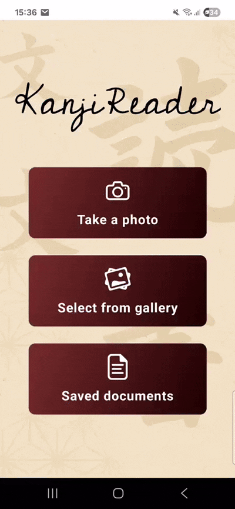

# Welcome to the KanjiReader app 👋

**KanjiReader** is a mobile app that helps you understand Japanese text more easily.
With **OCR** (optical character recognition) it can read Japanese characters from images, automatically **translate them into English**, and add **Furigana** (reading aids above Kanji). Ideal for language learners, travelers, or anyone dealing with Japanese text!

The app is built with [React Native](https://reactnative.dev/) and [Expo](https://expo.dev/).

## Features

* **OCR**: Extract Japanese text from images
* **Translation**: Automatic translation into English
* **Furigana**: Display reading aids above Kanji for better understanding
* **Platform**: Currently available on **Android** (iOS support planned)

Here’s a short demo of **KanjiReader** in action:



## Getting Started

1. Install dependencies

   ```bash
   npm install
   ```

2. Start the app

   ```bash
    npx expo start
   ```

In the output you’ll find options to open the app in:

* [Development build](https://docs.expo.dev/develop/development-builds/introduction/)
* [Android emulator](https://docs.expo.dev/workflow/android-studio-emulator/)
* [Expo Go](https://expo.dev/go) (limited testing environment)
